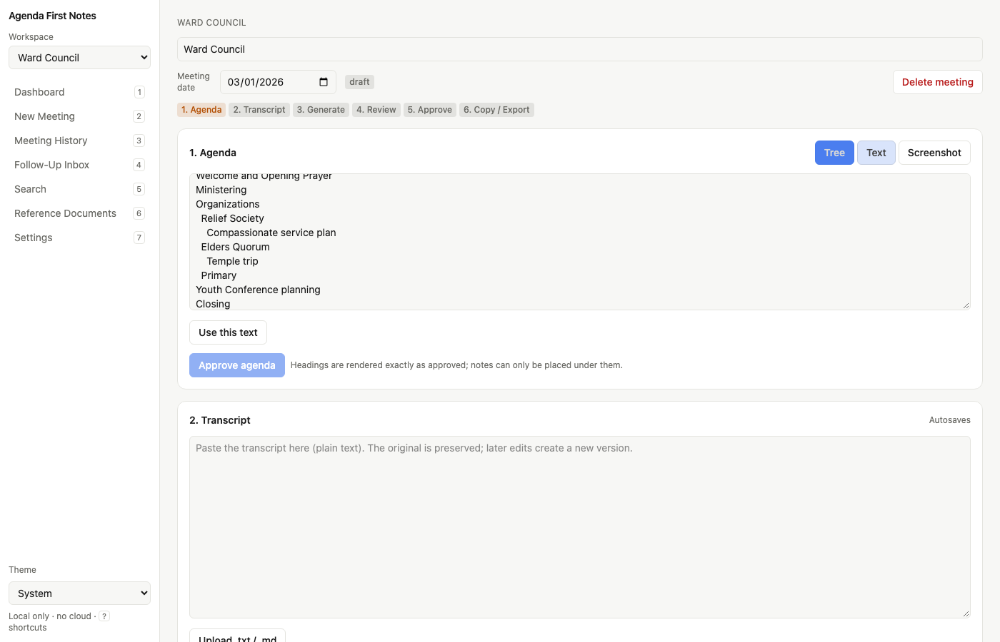
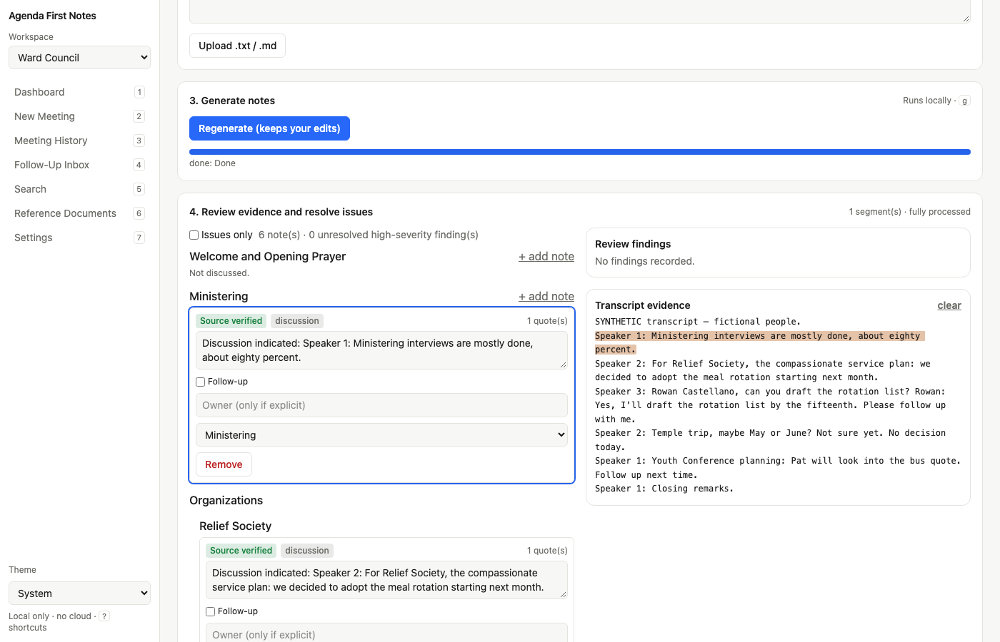
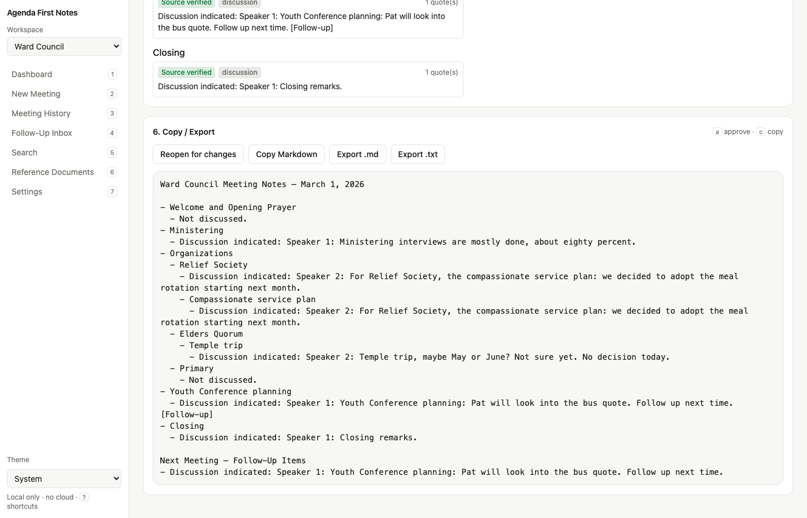
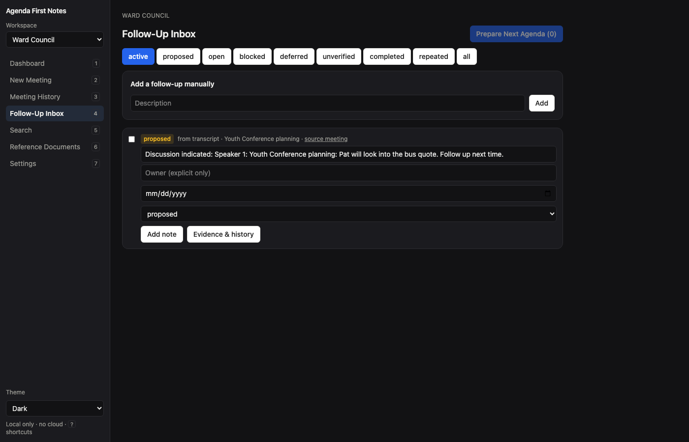

# Agenda First Notes

Local-first meeting notes that **preserve the agenda exactly**, **ground every claim in the transcript**, and **remember decisions and follow-ups across meetings** without letting history leak into today's notes.

Built for two separate workspaces out of the box — **Ward Council** and **Bishopric** — each with its own database, files, history, prompts and search index. No cloud AI, no telemetry, no accounts. All inference runs on your machine through [Ollama](https://ollama.com).

> This is an independent open-source project. It is not affiliated with, endorsed by, or approved by any church. Meeting notes may be confidential records; see [Privacy and limitations](#privacy-and-limitations).

## What it does

1. Choose a workspace, create a meeting.
2. Add the agenda — paste a screenshot (⌘V / Ctrl+V), drop PNG/JPEG/WebP files, paste text, or type it. Fix the extracted tree (indent, reorder, edit) and **approve** it. The approved agenda is immutable; later edits create a new revision.
3. Paste the transcript (autosaved and versioned; corrections are explicit and auditable).
4. **Generate notes.** The transcript is split into overlapping segments and processed by your local model. Every proposed note must cite verbatim transcript quotes; quotes that do not exist are rejected, inferred owners are stripped, overconfident wording is flagged.
5. **Adversarial review** (optional, off by default; Settings → review rounds) runs up to N rounds with an optional second model. The built-in checks (quotes must exist, unnamed owners removed) always run. If it does not converge, the meeting is marked *Review Required* instead of pretending.
6. Review with evidence: click a note to highlight its supporting passage. *Issues only* mode shows just the problems. Edit freely — your edits are preserved on regeneration and labelled *User corrected* or *Manual, unverified*, never *Source verified*.
7. **Approve**, then copy clean Markdown or export `.md` / `.txt`. The Markdown is rendered deterministically from the approved agenda tree — the model never controls headings or hierarchy.
8. Approved notes feed the **Follow-Up Inbox**, **Decisions**, **Calling events** (Bishopric) and **Search** — as *proposals* you confirm, with evidence attached. Nothing in history is ever used to fill gaps in a new meeting's notes.

Output shape (always):

```
Ward Council Meeting Notes – March 1, 2026

- Welcome and Opening Prayer
  - Not discussed.
- Organizations
  - Relief Society
    - Compassionate service plan
      - Decided to adopt the meal rotation starting next month.
      - Rowan Castellano will draft the rotation list by the fifteenth. [Follow-up] [Owner: Rowan Castellano]
  - Elders Quorum
    - Temple trip
      - May or June proposed for the temple trip; no decision reached. [Follow-up]
- Closing
  - Not discussed.

Next Meeting – Follow-Up Items
- Rowan Castellano will draft the rotation list by the fifteenth. [Owner: Rowan Castellano]
- May or June proposed for the temple trip; no decision reached.
```

(All names and content in this repository are fictional.)

## Screenshots (synthetic data, rule-based stand-in model)

| Agenda tree editor | Evidence-linked review |
|---|---|
|  |  |

| Approved Markdown | Follow-Up Inbox |
|---|---|
|  |  |



## System requirements

- macOS, Windows or Linux. 64-bit.
- Python 3.12+ and [uv](https://docs.astral.sh/uv/).
- Node.js 20+ (only to build the UI once; not needed afterwards).
- [Ollama](https://ollama.com) running locally with at least one model. Memory needs depend on the model: a 7–9B model runs in ~8 GB; the 27–35B models used for development want 24 GB+. Smaller models work — select them in Settings and lower the context length.
- Optional for screenshot agendas: a vision-capable Ollama model (e.g. a `*-vl` or `llava` model) **or** [Tesseract](https://github.com/tesseract-ocr/tesseract) with `pip install pytesseract` (`uv sync --all-extras` includes it). Without either, type or paste the agenda as text.

## Install

### macOS

```sh
brew install uv node ollama          # or install each from its website
ollama serve &                       # if not already running as a service
ollama pull qwen3.8:27b              # any local model; smaller ones work too
git clone https://github.com/<you>/agenda-first-notes.git
cd agenda-first-notes
python3 run.py
```

Optional OCR fallback: `brew install tesseract`.

### Windows

1. Install [Python 3.12+](https://www.python.org/downloads/) (tick "Add to PATH"), [uv](https://docs.astral.sh/uv/getting-started/installation/), [Node.js LTS](https://nodejs.org) and [Ollama for Windows](https://ollama.com/download/windows).
2. In a terminal: `ollama pull qwen3.8:27b` (or a smaller model).
3. `git clone https://github.com/<you>/agenda-first-notes.git`, `cd agenda-first-notes`, then `py run.py`.

Optional OCR fallback: install Tesseract (UB Mannheim builds) and make sure `tesseract.exe` is on PATH.

### Linux

```sh
curl -LsSf https://astral.sh/uv/install.sh | sh
curl -fsSL https://ollama.com/install.sh | sh
sudo apt install nodejs npm         # or your distro's packages (Node 20+)
ollama pull qwen3.8:27b
git clone https://github.com/<you>/agenda-first-notes.git
cd agenda-first-notes
python3 run.py
```

Optional OCR fallback: `sudo apt install tesseract-ocr`.

## Launch

`python3 run.py` (or `py run.py` on Windows) builds the UI the first time, then starts the local server and opens your browser at a URL like

```
http://127.0.0.1:8765/#token=…
```

The `#token=` part is an access token that only your browser receives; keep using that URL (bookmark it). Without the token the API refuses requests, so other programs on the same computer cannot read your notes. Stop with Ctrl+C.

Advanced: `uv run --directory backend agenda-first-notes serve --port 9000 --no-browser`, `… paths`, `… migrate`, `… audit`.

### Choosing a model

Open **Settings**. The app lists models installed in your local Ollama, lets you pick a primary extraction model, an optional independent reviewer model, and an optional vision model for screenshots, and runs a synthetic test inference against each. Cloud or remote endpoints are refused.

Recommended: `qwen3.8:27b` (it can also read agenda screenshots). In the maintainer's tests it found the most facts and filed them best of the local models tried, at about 5–6 minutes per meeting on an M2 Ultra; `qwen3.6:35b-a3b` is about 3× faster but misses and misfiles more.

## Where your data lives

Never in this folder. The app uses the OS application-data directory via `platformdirs`:

| OS | Default |
|----|---------|
| macOS | `~/Library/Application Support/AgendaFirstNotes/` |
| Windows | `%LOCALAPPDATA%\AgendaFirstNotes\` |
| Linux | `~/.local/share/AgendaFirstNotes/` |

Inside: `settings.json` (model settings only), `api_token`, and `workspaces/ward_council/` and `workspaces/bishopric/`, each with its own `notes.sqlite3`, `uploads/`, `references/`, `exports/`. The member list, if you load one, is shared by both workspaces in `members.sqlite3`. Override with the `AFN_DATA_DIR` environment variable. `agenda-first-notes paths` prints the resolved locations. Deleting a meeting in the UI deletes its database rows and uploaded images.

## Privacy and limitations

- **Everything stays local.** No cloud inference, no fallback, no API keys, no telemetry, no analytics, no CDN assets, no automatic backups. Works offline once installed.
- **What the app cannot verify:** Ollama is a separate program. The app refuses to talk to anything but a loopback address, but it cannot see how your Ollama is configured (for example whether it also listens on your LAN). Set `OLLAMA_HOST=127.0.0.1` for Ollama if that matters to you.
- **No encryption at rest.** Data is stored in plain SQLite files with user-only permissions where the OS supports them. Turn on full-disk encryption (FileVault, BitLocker, LUKS).
- **Deleting is local.** Deleting a meeting does not remove copies captured by Time Machine, OneDrive, or other backup/sync tools.
- **Restricted data.** Do not import membership records, LCR exports, or other restricted organizational data. Church Technology Standards prohibit using LCR data and membership information in third-party software, and the General Handbook treats meeting notes as confidential Church records. Local execution does not change what you are authorized to process. This tool does not integrate with, scrape, or synchronize any membership system, by design.
- **Model quality varies.** Smaller models miss more and hallucinate more. The evidence checks catch invented quotes and inferred owners, but they cannot catch everything — always review before approving. Notes marked *Source verified* mean the cited quote exists and the reviewer found no issue, not that the summary is guaranteed correct.

## Troubleshooting

| Symptom | Fix |
|--------|-----|
| "Ollama not reachable" | Start Ollama (`ollama serve` or the desktop app). Check **Settings → Ollama host** is `http://127.0.0.1:11434`. |
| "No primary model selected" | Settings → pick a model. `ollama list` must show at least one. |
| "Missing or invalid API token" / blank page asking for a token | Open the full launch URL including `#token=…` printed in the terminal, or run `agenda-first-notes serve` again to print it. |
| Screenshot paste does nothing | Browser clipboard permissions vary; use the file chooser or paste the agenda as text. |
| "No local image-to-text backend" | Choose a vision model in Settings, or install Tesseract (and `pytesseract`), or type the agenda. |
| Processing is slow / machine swaps | Pick a smaller model, lower *Context length* and *Segment size* in Settings. Models run one at a time by default. |
| Meeting stuck in *Review Required* | Open *Issues only*, fix or dismiss each high-severity finding, then approve. The app will not auto-approve. |
| Interrupted job after restart | Jobs left running at shutdown are marked failed; click *Retry*. |
| Where are my files? | `uv run --directory backend agenda-first-notes paths` |

## Development

See [CONTRIBUTING.md](CONTRIBUTING.md), [ARCHITECTURE.md](ARCHITECTURE.md), [SECURITY.md](SECURITY.md) and [ROADMAP.md](ROADMAP.md). All fixtures and examples are synthetic.

## License

MIT — see [LICENSE](LICENSE). Third-party licenses: [docs/THIRD_PARTY_LICENSES.md](docs/THIRD_PARTY_LICENSES.md).
